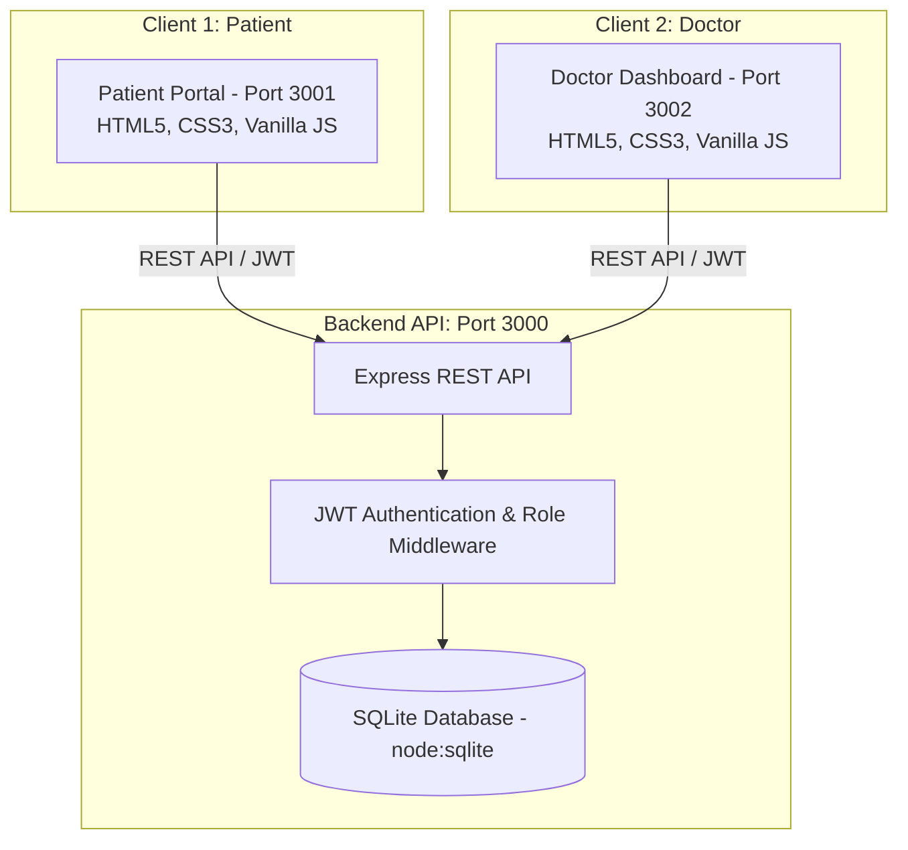

# 🏥 MediBook — Doctor Consultation & Appointment Booking System
### Full-Stack 2-Client Web Architecture with SQLite Database

MediBook is a full-stack doctor consultation and appointment booking application featuring a decoupled **2-client architecture**:
1. **Patient Portal (`http://localhost:3001`)**: Explore specialties, search doctors, browse available time slots, book video/phone/in-person consultations, view appointment history, and receive real-time notifications.
2. **Doctor Dashboard (`http://localhost:3002`)**: Manage clinic practice, view daily appointment queues, approve/decline consultation requests, write clinical diagnosis notes and prescriptions, manage weekly availability schedules, and view patient health records.
3. **Unified REST API Server (`http://localhost:3000`)**: Express.js backend with JWT authentication and SQLite database (`node:sqlite`).

---

## 🚀 Quick Start

### 1. Install Dependencies & Seed Database
```bash
npm install
npm run seed
```

### 2. Start Full Stack
Start all 3 services concurrently with a single command:
```bash
npm run dev
```

Or run individual services:
- **API Server**: `npm run start:server` (Port `3000`)
- **Patient Portal**: `npm run start:patient` (Port `3001`)
- **Doctor Dashboard**: `npm run start:doctor` (Port `3002`)

### 3. Run Automated Integration Tests
```bash
node test-e2e.js
```

---

## 🔑 Demo Credentials

| Role | Portal URL | Email | Password |
|---|---|---|---|
| **Doctor** | [http://localhost:3002](http://localhost:3002) | `sarah@clinic.com` | `password123` |
| **Patient** | [http://localhost:3001](http://localhost:3001) | `john@patient.com` | `password123` |

*Additional pre-seeded doctor accounts:* `james@clinic.com`, `priya@clinic.com`, `michael@clinic.com`, `emily@clinic.com` (all password: `password123`).

---

## 🌟 Key Features

### 👤 Patient Portal (`Port 3001`)
- **Doctor Discovery**: Filter by 8+ medical specialties (Cardiology, Dermatology, Pediatrics, etc.), search by doctor name, sort by rating or experience.
- **Smart Booking System**: Select date, browse real-time available time slots (booked slots are automatically locked), choose consultation type (in-person, video, phone), and enter symptoms/reason.
- **Appointment Management**: View upcoming and past appointments with live status badges (`pending`, `confirmed`, `completed`, `cancelled`).
- **Clinical Records & Rx Printing**: Read doctor prescriptions and consultation notes directly from the portal, or click **Print Rx** for an official, print-ready prescription document.
- **Virtual Video Consultation**: Click **Join Call** for confirmed video appointments to access the virtual consultation room with dual video streams, in-call messaging, and call controls.
- **Doctor Reviews**: Leave 1-5 star ratings and reviews for completed consultations.
- **Notifications**: Instant alert badge when doctors approve or update appointment requests.

### 🩺 Doctor Dashboard (`Port 3002`)
- **Practice Overview**: Real-time KPI stat cards for Today's Appointments, Pending Requests, Completed Consultations, and Total Revenue.
- **Appointment Queue**: Tabbed filtering (`All`, `Pending`, `Confirmed`, `Completed`, `Cancelled`) with one-click actions:
  - Approve or decline incoming requests
  - Mark completed with clinical notes and prescriptions
  - Start Video Call directly with the patient for confirmed virtual appointments
  - Mark no-show or cancel
- **Consultation Modal**: Detailed patient medical complaint view, plus diagnosis notes and prescription editor.
- **Prescription Generator & Printer**: Generate professional medical prescription sheets with clinic letterhead, doctor credentials, Rx notes, and digital signatures.
- **Schedule Management**: Interactive weekly availability toggles (Monday through Sunday) with customizable slot duration (15m, 30m, 45m, 60m) and consultation fee.
- **Patient Directory & Clinical History**: Click any patient in the directory to inspect their full multi-visit consultation timeline, past diagnoses, and prescriptions.
- **Doctor Profile**: Customize biography, consultation charges, and experience credentials.

---

## 🛠️ Architecture & Tech Stack



- **Frontend**: Responsive Vanilla CSS design system (Dark theme with Emerald/Teal accents for doctors, Ocean Blue for patients), Material Icons, zero external frontend framework overhead.
- **Backend**: Node.js & Express.js REST API with CORS, JWT authentication, and bcryptjs password encryption.
- **Database**: Zero-dependency SQLite engine using Node.js native `node:sqlite` (`DatabaseSync`), with WAL mode and foreign key integrity.
